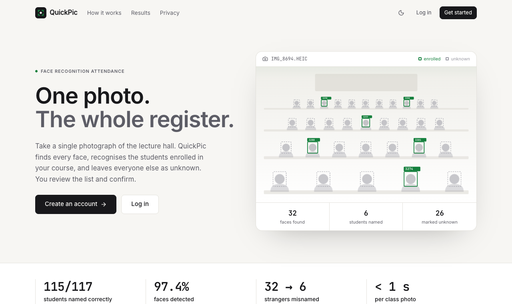
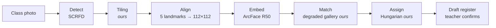
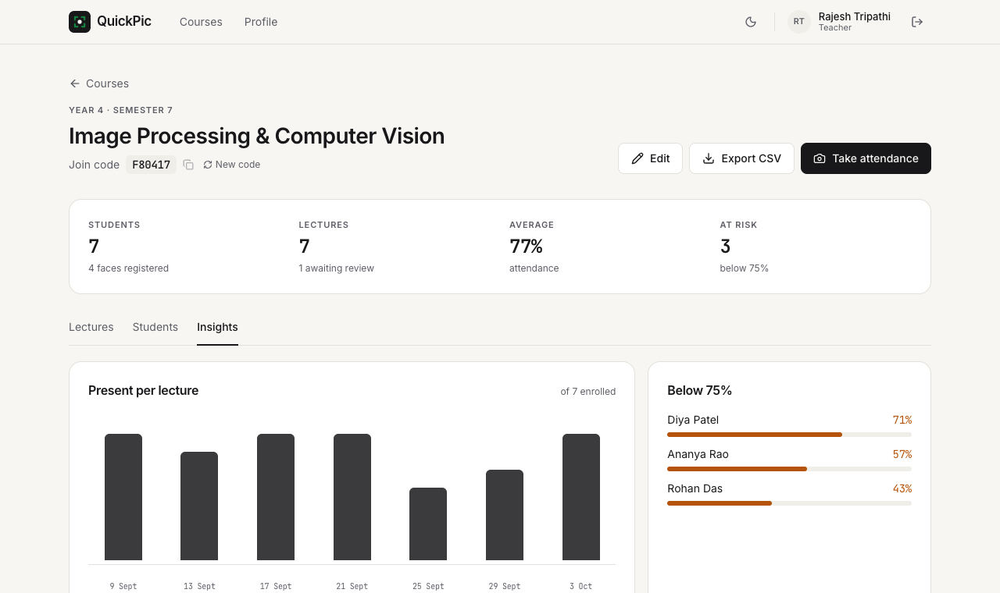
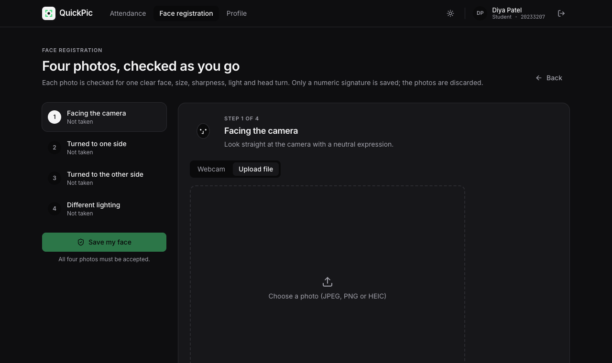

<div align="center">

# QuickPic

**One photo. The whole register.**

Classroom attendance from a single photograph: QuickPic finds every face, names the enrolled students, leaves everyone else as unknown, and hands the teacher a draft register to confirm.

[](https://github.com/Tanish-237/quickpic/actions/workflows/ci.yml)
[](LICENSE)


[Report (PDF)](paper/quickpic.pdf) · [Design decisions](docs/decisions.md) · IPCV course project, MNNIT Allahabad



</div>

## Highlights

- **115 of 117** enrolled-student appearances named correctly on 10 real class photos (69–102 faces each).
- **5× fewer strangers misnamed** than the pretrained baseline (32 → 6), from our classroom-aware decision layer.
- **97.4 %** of faces detected, including 30-pixel faces at the back of the room, thanks to tiled detection.
- **Under a second** per class photo on a laptop GPU (Apple M2 via CoreML), 6 s on CPU.
- **Knows when it is unsure:** names where another student scored almost as high are flagged for the teacher.
- **Privacy by design:** only face embeddings are stored; class photos are deleted on confirmation; nothing leaves the laptop.

## How it works



The detector and the face network are pretrained and frozen. Our contribution is the decision layer around them, where each part can be switched off for the ablation:

| Component | Problem it solves |
|---|---|
| **Tiled detection** | A 4032-px photo is shrunk to 640 px before detection, so back-row faces vanish. We detect on overlapping full-resolution tiles. |
| **Degradation-aware enrollment** | Registration selfies are sharp; classroom faces are small and blurred. Each student is stored with blurred, darkened and down-scaled copies. |
| **One-to-one assignment** | Two faces must never get the same name. All faces in a photo are assigned jointly with the Hungarian method; weak matches stay unknown. |
| Quality-aware calibration | Tested and reported: it helps faces under 20 px but not at classroom sizes, so it is off in the deployed system. |

## Results

10 real class photographs, 804 hand-labelled faces, 117 appearances of 15 enrolled students; thresholds chosen leave-one-photo-out (never tuned on the photo being scored).

| Configuration | Attendance F1 | Students named correctly | Strangers given a student's name |
|---|---|---|---|
| Pretrained baseline (SCRFD + ArcFace R50) | 0.954 | 114 / 117 | 32 |
| + tiled detection | 0.954 | 114 / 117 | 15 |
| + degradation-aware enrollment | 0.966 | 115 / 117 | 15 |
| **+ one-to-one assignment (deployed)** | **0.966** | **115 / 117** | **6** |

Also evaluated on LFW (99.8 % verification), TinyFace (open-set identification on 20-pixel faces) and an Indian classroom sample from IIT Madras (98.5 % rank-1). Every number is produced by a script in [`experiments/`](experiments) and saved in [`experiments/results/`](experiments/results); the full study is in the [report](paper/quickpic.pdf).

## The app

| Teacher: course insights | Student: guided face registration |
|---|---|
|  |  |

**Teachers** create courses, upload a class photo and review every detected face on a zoomable photo: green = named, amber "?" = unsure, dashed = unknown. They fix names (one face per student is enforced), tick the register and confirm; the photo is then deleted. Course pages show per-lecture and per-student attendance, students below 75 %, and CSV export. Lectures, marks and courses can be edited or deleted, and join codes regenerated.

**Students** sign up, join a course with its six-letter code, and register their face with four guided photos (webcam with countdown, or file upload). Each photo is checked instantly for one face, size, sharpness, lighting and head turn, and the aligned face is shown back. Students see their attendance per lecture, can leave a course, and can delete their face data or account at any time.

## Quick start

Requirements: [uv](https://docs.astral.sh/uv/), Node.js 20+ and [pnpm](https://pnpm.io/). Runs fully offline after setup.

```bash
git clone https://github.com/Tanish-237/quickpic && cd quickpic
make setup     # Python env (uv.lock) + frontend packages
make models    # download pretrained face models into models/ (checksummed)
make web       # build the frontend and serve the app on http://127.0.0.1:8000
```

Create accounts in the app (teacher sign-up code: `ipcv-2026`), or seed demo data from a folder of enrollment photos (`data/class/enroll/<student name>/*.jpg`):

```bash
make demo      # teacher / quickpic-demo, one course, one student per folder (password quickpic-demo)
```

To start fresh, delete `web/quickpic.sqlite3` and `web/media/`. Run `make help` for every command.

### Configuration

All optional, set as environment variables:

| Variable | Default | Purpose |
|---|---|---|
| `QUICKPIC_DEVICE` | `coreml` on Apple silicon, else CPU | `cpu`, `coreml` or `cuda` |
| `QUICKPIC_TEACHER_CODE` | `ipcv-2026` | Code required to sign up as a teacher |
| `QUICKPIC_UNSURE_MARGIN` | `0.06` | Flag a name when the runner-up student scored within this margin |
| `QUICKPIC_SECRET_KEY`, `QUICKPIC_DEBUG` | demo values | Django secret key and debug mode |
| `QUICKPIC_DB`, `QUICKPIC_MEDIA`, `QUICKPIC_MODELS` | inside the repo | Database file, upload folder, model folder |

## Tech stack

| Layer | Technology |
|---|---|
| Vision | SCRFD, YuNet, Haar · ArcFace (ResNet-50, MobileFaceNet), SFace, LBP · ONNX Runtime (CPU, CoreML, CUDA) · OpenCV |
| Decision layer | NumPy, SciPy (Hungarian method), scikit-learn (calibration) |
| Backend | Django 6, Django Ninja (typed JSON API, session auth + CSRF), SQLite, WhiteNoise |
| Frontend | React 19, TypeScript, Vite, Tailwind CSS 4, TanStack Query, React Router |
| Tooling | uv, pnpm, Ruff, Prettier, pytest, GitHub Actions, Colab (GPU benchmarks) |

## Repository layout

```
quickpic/
├── src/quickpic/          Recognition engine: detection, alignment, embedding, tiling,
│                          degradation, calibration, assignment, metrics (no UI code)
├── web/                   Django backend
│   ├── attendance/
│   │   ├── api/           JSON API: auth, account, student, courses, sessions
│   │   ├── engine.py      Bridge to the engine: registration checks, processing, confirmation
│   │   └── models.py      Users, courses, face embeddings, lectures, attendance
│   └── config/            Settings and URLs (serves the built frontend)
├── frontend/              React app
│   └── src/
│       ├── components/    UI kit and app shell
│       ├── lib/           API client, auth context
│       └── pages/         Landing, auth, profile, student/, teacher/{course,session}/
├── experiments/           Scripts behind every number in the report → results/*.json
├── notebooks/             Colab notebooks for the GPU benchmarks
├── tools/                 Local face-labelling tool that builds the answer key
├── tests/                 Engine unit tests (API tests live in web/attendance/tests.py)
├── paper/                 IEEE report (LaTeX + PDF)
├── docs/                  Design decisions and README screenshots
└── scripts/               Model download, no-images guard
```

The API is documented interactively at `http://127.0.0.1:8000/api/docs` while the app is running.

## Development

```bash
make check     # what CI runs: no-images guard, Ruff, Prettier, TypeScript, pytest, API tests
make format    # auto-format Python and TypeScript
make api       # Django on :8000   ─┐ run both for a live-reloading
make dev       # Vite on :5173     ─┘ frontend at http://127.0.0.1:5173
```

Experiments: `uv run python -m experiments.<name> --data data/class` (class-photo studies run locally only); the public benchmarks run on Colab from [`notebooks/`](notebooks).

## Privacy and licences

- No face image is ever committed: `data/` and `models/` are git-ignored, and CI fails if an image outside `docs/assets/` is tracked. The screenshots above use invented students.
- Class-photo experiments run only on the authors' laptop and report aggregate numbers. Enrolled classmates gave permission; other people in class photos are never identified or published.
- Code: MIT. The InsightFace models are for **non-commercial research only**; SFace and YuNet (OpenCV Zoo) are Apache-2.0/MIT. LFW, TinyFace and the ICFD sample are used for research and not redistributed.

## Team 25

| Member | Contribution |
|---|---|
| **Tanish Mittal** (20233288) | Lead: system design, recognition engine and decision layer, web app architecture (API, review screen), GPU acceleration, class-photo evaluation, report |
| **Shashank Kanaujiya** (20233259) | Face detection, tiled detection, detector comparison, class-photo labelling |
| **Utkarsh Raj Singh** (20233298) | Datasets and evaluation protocol, public benchmarks (LFW, TinyFace, ICFD), face-model comparison, calibration study |
| **Shinde Ritesh Tirupati** (20233350) | Web app pages (sign-up, guided registration, dashboards), testing, photo collection, literature survey |

Image Processing and Computer Vision, Semester VII, Section D · Motilal Nehru National Institute of Technology Allahabad
